<!-- Bannière animée -->
<p align="center">
  
</p>

<!-- Texte tapé à la machine -->
<p align="center">
  <a href="https://github.com/vince614">
    
  </a>
</p>

<p align="center">
  <a href="https://discordinvites.net"></a>
  
  
</p>

---

## 🧑‍💻 About me

```ts
const vince = {
  location: "Paris, France 🇫🇷",
  codingSince: 2016,
  currentFocus: ["Next.js", "TypeScript", "Node SDKs"],
  background: ["PHP / Symfony", "Magento 2 modules", "OroCommerce"],
  sideProject: "https://discordinvites.net",
  funFact: "I love building Discord bots and multiplayer games 🎮",
};
```

## 🛠️ Tech stack

<p align="center">
  
  <br/>
  
</p>

## 🚀 Featured projects

| Project | Description | Stack |
|---|---|---|
| [**discordinvites-next**](https://github.com/vince614/discordinvites-next) | Frontend of DiscordInvites.net |  |
| [**discordinvites-node-sdk**](https://github.com/vince614/discordinvites-node-sdk) | Official Node.js SDK for the DiscordInvites API |  |
| [**agario**](https://github.com/vince614/agario) | Multiplayer cell-eating game |  |
| [**chatbot**](https://github.com/vince614/chatbot) | Conversational bot |  |
| [**colissimo-rule**](https://github.com/vince614/colissimo-rule) | Colissimo shipping rules module for Magento 2 |  |
| [**BotDashboard**](https://github.com/vince614/BotDashboard) | Web dashboard for Discord bots |  |

## 📊 GitHub stats

<p align="center">
  
  
</p>

<p align="center">
  
</p>

<p align="center">
  
</p>

<sub><p align="center">Cards auto-generated every 12 h by a GitHub Action in this repo ⚙️</p></sub>

<!-- Bannière de pied de page -->
<p align="center">
  
</p>
